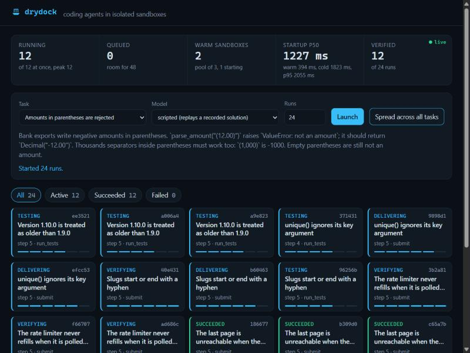
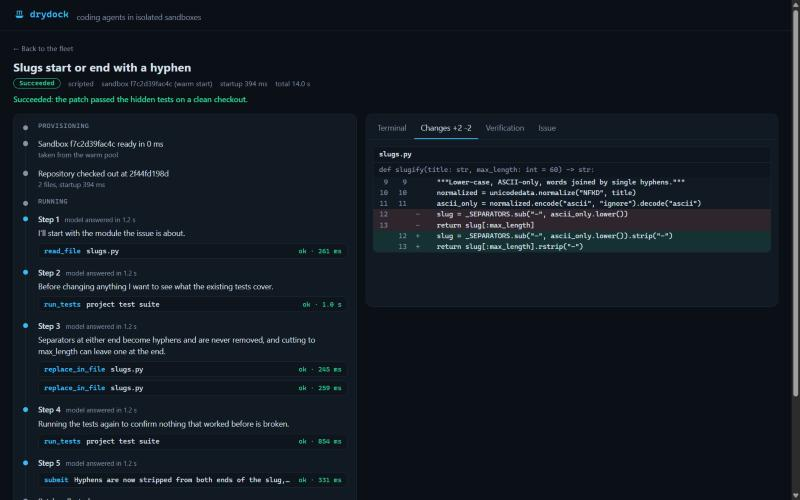

# Drydock

Runs coding agents in locked-down container sandboxes, and believes none of them.

An agent gets a repository and an issue, works through tools (read, search, edit, run tests), and submits. Drydock then takes the diff, applies it to a clean checkout in a second sandbox, and runs tests the agent never saw. Only that result counts.





## Why the second sandbox matters

From the first evaluation of a local 7B model on the bundled tasks:

- On one task the model diagnosed the bug correctly, wrote "the tests have passed after adding the sorting step", and submitted. It had not edited a file.
- On another it made a change that did nothing, saw the visible tests pass (they had been passing all along), and declared the issue fixed.

Both runs ended as failures, on the record, because the verdict comes from the diff and the hidden tests, not from what the agent says.

## What is in it

- **Sandboxes.** One container per run: no network, no capabilities, read-only root, a non-root user, and limits on memory, CPU and process count. Every command has a deadline enforced inside the sandbox, so background children die with it.
- **A warm pool and a repository cache.** Sandboxes are started ahead of demand. Repositories are mirrored once by a separate fetcher (the only container with network access, which never runs a model-chosen command) and cloned with `--shared`, so a checkout copies no git objects.
- **An event log as the source of truth.** Everything a run does is appended to a per-run log. The live UI is a subscription to it, a reconnecting browser resumes from the last sequence number it saw, and a restarted server rebuilds every run's state by reading the logs back.
- **A scheduler with back-pressure.** A bounded queue that refuses work it cannot hold, a concurrency limit, cancellation, and reaping of sandboxes orphaned by a crash, scoped to a namespace so two orchestrators can share a host.
- **A patch the agent cannot forge.** The diff is computed against the read-only mirror, not against the `.git` directory in the workspace, the agent's commits, or its git configuration.
- **A control plane.** A React app embedded in the binary: a live fleet grid, and for each run the reasoning, tool calls, terminal output, diff and verification.

## Measured

### Startup

Time until a command can run against a checkout of `pallets/click`, on one laptop with Docker Desktop (WSL2):

| Arm | What it does | Samples | p50 | p95 |
|---|---|---:|---:|---:|
| naive | base image; install git and the test runner; clone over the network | 5 | 13,719 ms | 15,383 ms |
| prebuilt image | tools baked into the image; clone over the network | 5 | 1,499 ms | 1,714 ms |
| + repository cache | hardened sandbox; clone from the local mirror | 20 | 159 ms | 165 ms |
| + warm pool | sandbox already started and waiting | 20 | 60 ms | 68 ms |

These are one run at a time. The next table is what happens when 128 arrive at once.

### Concurrency

128 scripted agents submitted at once, all allowed to run concurrently, on the same laptop. A scripted agent replays a recorded solution with a 2 s pause before each turn, so this measures the harness (scheduling, sandboxes, checkouts, the event log, verification), not a model. Full reports are in [bench/](bench/).

| | Pool of 16 | Pool of 128 |
|---|---:|---:|
| Runs with a patch verified in a second sandbox | 128 of 128 | 128 of 128 |
| Peak runs executing at once | 128 | 128 |
| Peak containers running at once | 180 | 287 |
| Wall time | 50.1 s | 41.3 s |
| Startup p50 / p95 / max, all runs | 11.3 / 13.0 / 13.2 s | 1.8 / 3.0 / 3.6 s |
| Startup of runs that got a pooled sandbox | 0.3 s p50 (16 runs) | 1.8 s p50 (128 runs) |
| Startup of runs whose sandbox was created on demand | 11.8 s p50 (112 runs) | none |

With 112 containers created at once, each waited about 12 s on the container runtime. With the pool sized to the burst, every run started from it, and the slowest start was 3.6 s; that is slower than the 60 ms of a single warm start because 128 checkouts and the pool's refill compete for the same machine.

### Isolation

15 tests start a real sandbox and try, from the inside, to do what it should prevent (`go test -tags integration ./internal/...`): user id, capabilities, no-new-privileges, memory, swap, process and CPU limits read from the kernel's accounting, a read-only root and cache, no network and no DNS, a fork bomb that stops at the process limit, a 900 MiB allocation killed inside a 512 MiB sandbox, a deadline that kills foreground and background children, output capped in memory but streamed in full, and orphan reaping that leaves other namespaces alone. Four more check that an agent cannot change what its patch says: deleting its `.git` directory, committing its change, or rewriting its git configuration still yields the true diff. With the unit tests, 41 tests in all, every one passing.

### Model evaluation

Eight small Python repositories with a seeded defect each. A task is fair by construction: its visible tests pass on the shipped code and its hidden tests fail (`scripts/check-tasks.sh` checks this).

| Run | Model | Resolved | Notes |
|---|---|---:|---|
| First | qwen2.5:7b via Ollama | 0 of 8 | Five model failures and three harness failures. The harness failures are what the next row fixes. |
| Second | qwen2.5:7b via Ollama | 2 of 8 | One of the six failures was the harness again: a second server sharing the cache replaced a mirror under a running agent. Fixed since, by making imports immutable. |

The second row predates the last two fixes and should be rerun. Scripted runs, which replay a recorded solution through the real sandbox and verification path, pass 24 of 24.

## What the evaluations changed

Running a weak model was the best test the harness had:

- `submit` is refused, twice at most, while no file has changed.
- The prompt tells the agent to reproduce the issue when the existing tests already pass.
- The Ollama backend sets the context window. The default of 4,096 tokens overflowed around step 9, and the server drops the oldest tokens without saying so.
- Reaping is scoped to a namespace. A test run on the same daemon had removed a live evaluation's sandboxes.
- Imports are content-addressed and immutable.
- A pooled sandbox that has vanished is replaced instead of failing the run.

## Run it

```bash
docker build -t drydock-sandbox:python images/python
(cd web && npm ci && npm run build)
go build -tags ui -o drydock ./cmd/drydock

./drydock serve --addr :8080          # control plane on http://localhost:8080
./drydock run --task slug-stray-hyphens
./drydock eval --model ollama:qwen2.5:7b
./drydock bench startup
```

The binary talks to Docker over a Unix socket or TCP, so on Windows run it in WSL or in a container with the socket mounted.

## What is not here

- **More than one host.** Sandboxes are containers on a single Docker daemon. The driver is an interface; a Kubernetes driver is the obvious next one and is not written.
- **Stronger isolation than containers.** gVisor or microVMs would be the next step for hostile code.
- **Context management.** Long conversations are not summarised; a run that outgrows the model's context is not handled.
- **CI.** The tests have been run locally, not in a pipeline.

## Layout

```text
cmd/drydock/            serve, run, eval, bench startup, bench load
internal/engine/        a small Docker Engine API client: exec over a hijacked connection, stream demultiplexing
internal/sandbox/       the hardened driver, warm pool, repository cache
internal/events/        the append-only per-run log and its subscriptions
internal/model/         Ollama, OpenAI-compatible and scripted backends
internal/agent/         the loop and its tools
internal/orchestrator/  scheduling, the run lifecycle, verification
internal/api/           HTTP and server-sent events
web/                    the React control plane
tasks/                  eight repositories with a seeded defect, an issue and hidden tests
```
